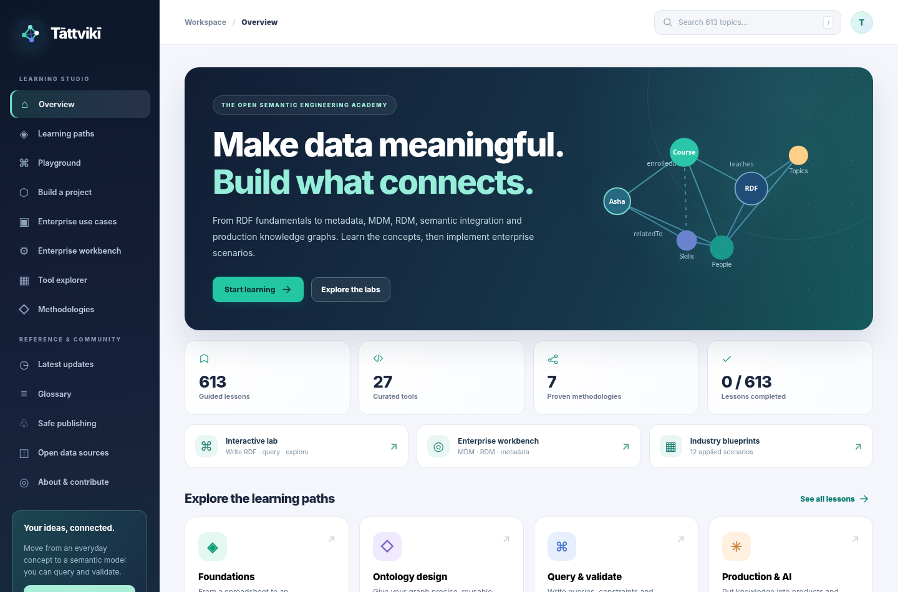

# Tāttvikī — free ontology and knowledge graph learning



**v4 curriculum:** 613 distinct learning entries = 13 original foundational lessons + 240 legacy micro-lessons + 360 additional enterprise-focused topics across 15 modules and 14 learning paths. Includes 12 detailed industry blueprints, an interactive MDM/RDM teaching workbench and two downloadable executable Python KG labs. See `CURRICULUM.md` and `LEGAL_AND_DATA_REVIEW.md` for depth and rights disclosure.


A **working, no-backend learning website** for making ontology and knowledge-graph concepts approachable. All pages and in-browser exercise checks work without accounts or paid APIs.

## Included

- 613 uniquely named topics, with a clear separation between foundational chapters, micro-lessons and topic-specific enterprise implementation briefs.
- Browser-local progress and code edits (localStorage only; no accounts, cookies, or analytics).
- Offline Turtle playground with prefixes, multiple statements, semicolon predicate lists, comma object lists, datatype and language literals, plus useful line-level syntax errors.
- Optional **real Turtle parsing** using [N3.js](https://github.com/rdfjs/N3.js) from a public CDN when the learner explicitly selects “Extended parser (online)”. Network required for that button only. No code is submitted to Tāttvikī servers.
- A **limited offline SPARQL practice interpreter** supporting PREFIX, SELECT, DISTINCT, basic graph patterns/joins, ORDER BY, LIMIT and OFFSET. It is **not** a general SPARQL or SHACL engine.
- SVG graph explorer with clickable RDF resources.
- **Two runnable enterprise capstone projects**: `projects/enterprise-kg` (1,014-triple integrated KG), and `projects/enterprise-mdm-rdm-metadata` (synthetic CRM + ERP source records, SKOS reference mappings, master record consolidation, DCAT metadata, PROV lineage, executable SPARQL, pySHACL and unit tests). The original `projects/study-kg` introductory example is included too.
- 12 original enterprise blueprints (finance, clinical research, retail, manufacturing, IT, procurement, logistics, AI etc.), 27 tool references, seven methods, a glossary and local content search.
- Curated W3C standards references and a daily GitHub Action which retrieves latest official software release **metadata** from selected repositories. No AI-generated news or invented dates.
- Responsive, accessible, static assets and no build step.

## Project creator and intellectual property

Created by **Shubham**. Code: MIT; original educational text/examples: CC BY 4.0; all sample records are invented. This has received a preliminary licensing/PII audit only — **not a formal legal opinion**. See `LEGAL_AND_DATA_REVIEW.md`; run a trademark check for “Tāttvikī” before public launch.

## Run locally

Use Python's built-in server from the project folder:

```bash
cd Tattviki
python -m http.server 8000
```

Open http://localhost:8000 . The file can also be opened directly, but latest-updates JSON may not load from `file://` due to browser security policy.

## Host free on GitHub Pages

1. Create a **public** repository (for example `tattviki`) and copy **the contents** of this folder into its root.
2. Commit and push to the `main` branch.
3. In **Settings → Pages**, set **Source = GitHub Actions**.
4. In **Actions**, enable workflows if prompted. `pages.yml` publishes on push and refreshes release data daily around 07:15 UTC. GitHub may delay or skip scheduled runs under heavy load.
5. Your site should appear at `https://YOUR-USERNAME.github.io/tattviki/` after the deployment succeeds. The link is an example, **not an existing deployment**.

No npm, server hosting, domain purchase, API subscription or database is required. A custom domain is optional and may cost money.

## Maintain and contribute

- `assets/content.js`, `assets/curriculum.js`, `assets/deepdives.js`: legacy course material.
- `assets/enterprise_curriculum.js`: 360 new lessons in 15 industry/engineering modules and 10 new learning paths.
- `assets/enterprise_cases.js`: 12 original enterprise case blueprints.
- `assets/app.js`: view rendering, in-browser RDF/SPARQL practice, local sample graphs and MDM/RDM teaching workbench logic.

- `assets/styles.css`: redesigned professional, responsive styling.
- `scripts/test_browser.py`: optional Playwright browser interaction regression tests (run locally after installing Playwright + Chromium).
- `data/updates.json`: curated standards cards + published release metadata.
- `scripts/refresh_updates.py`: transparent source-refresh script (uses public GitHub release API; skips failed sources).
- `.github/workflows/pages.yml`: daily scheduled publish and update.

Only add third-party content when you have the right to republish it. Publicly available data is not automatically open-licensed. For lesson updates, include a source URL, status (e.g., Working Draft vs Recommendation), last verification date and an example a learner can actually run. Prefer primary standards and project documentation over marketing copy. Check links and license claims periodically.

### Starter lab scope and next engineering milestones

The offline Turtle parser supports common Turtle shorthand (`;` and `,`), prefix declarations, language-tagged and typed literals; it does **not** support all Turtle syntax (e.g. bracketed blank-node property lists, collections, multiline quoted literals or RDF-star). The optional N3.js button provides real Turtle syntax validation online. The built-in SPARQL interpreter handles only the subset listed above; for general SPARQL 1.1/1.2, integrate a mature engine such as [Comunica](https://comunica.dev/) or a server-side RDF4J/Jena/Oxigraph service. For SHACL validation, integrate a real [pySHACL](https://github.com/RDFLib/pySHACL) service or a browser-compatible validator. OWL reasoning requires an actual reasoner. Do not describe the current playground as production ready.

Potential next features: exercises in OWL and SKOS, SHACL reports, video/illustrations, reusable examples, Hindi/Marathi content, contributor editorial review and accessibility testing with learners.

## Privacy & licenses

Code: MIT (see LICENSE). Original instructional content: CC BY 4.0 (see CONTENT-LICENSE.md). External linked standards/software remain governed by their own terms. Browser editor/progress state stays on the user's device.

### Windows quick start

Double-click `START_WINDOWS.bat` if Python 3 is already installed. It opens a local web server and launches the site in your default browser. Close the terminal to stop the server.

### Enterprise capstone walkthrough

```bash
cd projects/enterprise-mdm-rdm-metadata
python -m pip install -r requirements.txt
python generate.py
python run_queries.py
python -m unittest -v test_lab.py
python generate.py --break-shape   # intentional SHACL violation, nonzero exit expected
```

SHACL validation runs with `pyshacl` installed. Without it, the generator prints a dependency warning instead of fabricating a successful validation. The browser workbench implements real, local synthetic string-comparison scoring and RDM code lookup, **not** full enterprise entity resolution or a production catalog.

### Changes in version 4
- Credits display **Shubham** only. No real employer/client information has been intentionally included in sample records.
- Replaced restricted-terminology lesson names and case text with open-ontology use cases and a separate **Open data sources** reference page. None of those external data resources are bundled.
- Added 3 selectable Turtle/SPARQL practice datasets, offline Turtle shorthand support, ORDER BY / OFFSET, RDF export, copy fallback and improved explanations for non-executable examples.
- Redesigned home, lab and lesson directory; added search and pagination to the 613-topic library.
- Validated routes, editor changes, 3 challenge queries, enterprise workbench, quiz completion, mobile navigation and download via headless Chromium.
- The optional extended parser still requires an external CDN connection; do not rely on it for offline use. OWL reasoner and server-side SHACL are not built into the browser.

### Optional UI regression testing

```bash
python -m pip install playwright
python -m playwright install chromium
python scripts/test_browser.py
```

This test harness injects locally packaged JS/CSS into a headless Chromium page to avoid external network dependencies. It verifies interaction logic but cannot replace a live GitHub Pages smoke test. Screenshots are written to the system temporary directory. The GitHub publishing workflow additionally checks route rendering and curriculum integrity with Node.js.
