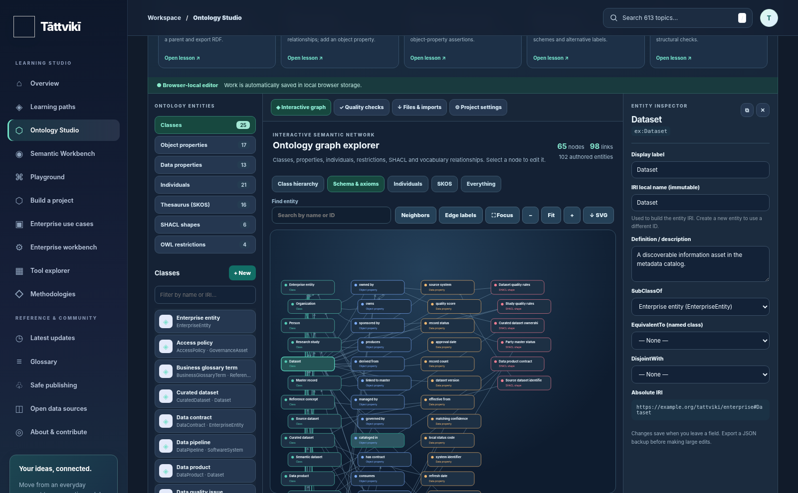
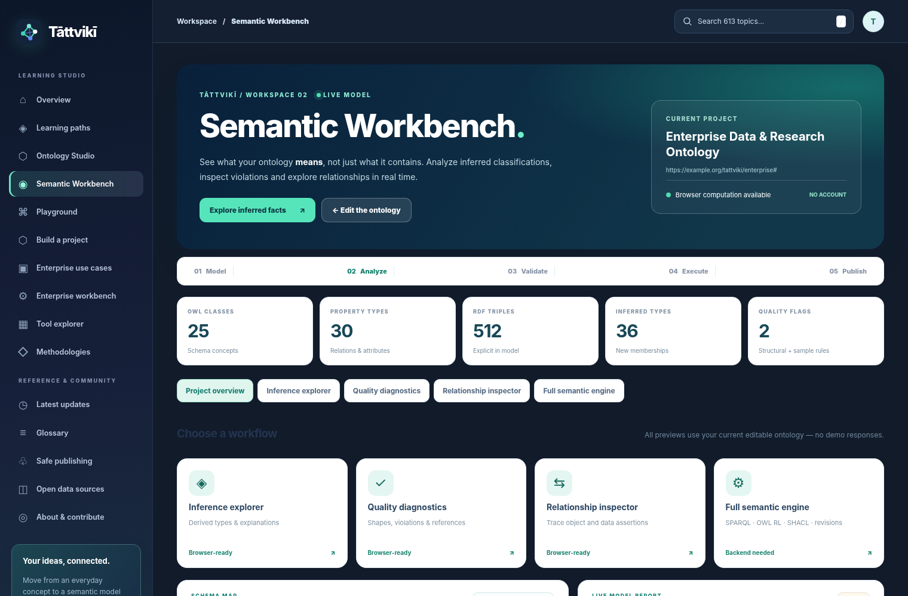

<div align="center">

# Tāttvikī

### Learn ontology engineering. Build knowledge graphs. Explore enterprise semantics.

**A free, open-source learning platform and hands-on semantic engineering workspace.**

[**Website**](https://shastramfreak-ui.github.io/tattviki/) · [**Ontology Studio**](https://shastramfreak-ui.github.io/tattviki/#studio) · [**Semantic Workbench**](https://shastramfreak-ui.github.io/tattviki/#semantic) · [**Curriculum**](CURRICULUM.md) · [**Contribute**](CONTRIBUTING.md)

**Version 8** · **613 learning topics** · **15 learning modules** · **12 enterprise use-case blueprints**

**Created by Shubham**

</div>



**[Open the live Studio](https://shastramfreak-ui.github.io/tattviki/#studio)** · [Create a new ontology](https://shastramfreak-ui.github.io/tattviki/#studio) · [View the project templates](previews/studio-v8-new-ontology.png)

> **Deployment note:** The website links above refer to this repository's expected GitHub Pages address. The site is available there only after a successful GitHub Pages deployment.

## Table of contents

- [What is Tāttvikī?](#what-is-tāttvikī)
- [Features and capabilities](#features-and-capabilities)
- [Explore the learning paths](#explore-the-learning-paths)
- [Get started locally](#get-started-locally)
- [Visual Ontology Studio v8](#visual-ontology-studio-v8)
- [Semantic Workbench](#semantic-workbench)
- [Enterprise projects](#enterprise-projects)
- [Optional advanced backend](#optional-advanced-backend)
- [Deploy to GitHub Pages](#deploy-to-github-pages)
- [Project structure](#project-structure)
- [Tests and quality checks](#tests-and-quality-checks)
- [Privacy, licenses, and responsible use](#privacy-licenses-and-responsible-use)
- [Contributing](#contributing)

## What is Tāttvikī?

**Tāttvikī** makes ontology development, knowledge graphs, and enterprise semantic technologies approachable through guided lessons, editable examples, visual modeling, and executable projects.

It brings together:

- **Foundations:** data and information modeling, vocabularies, taxonomies, thesauri, RDF, RDFS, OWL, SKOS, SPARQL, and SHACL.
- **Ontology engineering:** classes, properties, individuals, axioms, annotations, class hierarchies, model quality, and RDF exports.
- **Enterprise semantics:** metadata catalogs, data lineage, master data management (MDM), reference data management (RDM), governance, integration, and knowledge-graph pipelines.
- **Advanced topics:** reasoning, GraphRAG, semantic interoperability, data products, architecture patterns, and domain-focused implementations.

The **613 entries** consist of foundational lessons, concise micro-lessons, and enterprise topic briefs. They are *not* all full textbook-length chapters. See [CURRICULUM.md](CURRICULUM.md) and [the searchable topic index](CURRICULUM_INDEX.csv).

## Features and capabilities

| Capability | Free browser experience | Optional local backend |
| --- | --- | --- |
| Lessons, quizzes, searchable glossary and progress | ✅ | Not required |
| Turtle practice, beginner SPARQL challenges and graph explorer | ✅ Teaching subset | Not required |
| Visual OWL/RDF ontology modeling | ✅ Interactive graph, zoom/pan/focus | Not required |
| New blank ontology and multi-domain project starters | ✅ | Not required |
| Class/property/individual/SKOS/SHACL graph views | ✅ | Not required |
| Guided lessons linked directly to Studio | ✅ | Not required |
| Classes, properties, individuals, SKOS concepts and selected axioms | ✅ | Not required |
| Turtle, RDF/XML, JSON-LD and diagram export | ✅ | Not required |
| Browser RDFS inference preview and explained findings | ✅ Supported subset | Not required |
| Relationship inspection and structural quality diagnostics | ✅ Supported subset | Not required |
| General SPARQL execution on an ontology | — | ✅ RDFLib, read-only |
| OWL RL inference and SHACL Core validation | — | ✅ `owlrl` and `pySHACL` |
| Shared projects, access roles and version history | — | ✅ SQLite-backed API |
| Experimental OWL DL classification | — | ⚠️ Optional Java/HermiT adapter |

**Scope matters:** the browser parser, SPARQL practice interpreter, inference preview, and quality checks are educational subsets—not complete implementations of their underlying standards. The local backend supports more advanced features but is **not a production-ready public service**. Full Protégé/WebProtégé feature parity is not claimed.

### The Semantic Workbench



In **Semantic Workbench** (`#semantic`), analyze the ontology currently open in the Studio:

- View inferred class memberships and their explanations.
- Inspect explicit relationships and browse classes.
- Run browser-side structural/quality diagnostics.
- Export displayed findings as CSV.
- Switch to the **Full semantic engine** when a separately running backend is available.

The browser-only analysis works on GitHub Pages; the advanced engine and shared revisions do not run on GitHub Pages itself.

## Explore the learning paths

| Area | Example subjects |
| --- | --- |
| Semantic foundations | Knowledge representation, identifiers, controlled vocabularies, thesauri |
| RDF and linked data | IRIs, triples, graphs, Turtle, JSON-LD, RDF datasets |
| Ontology modeling | RDFS, OWL classes, properties, constraints, design patterns |
| SKOS and reference data | Concepts, labels, hierarchies, mapping, terminology governance |
| Query and validation | SPARQL, SHACL, competency questions, data-quality checks |
| Knowledge-graph engineering | ETL/ELT, graph construction, integration, lineage, entity resolution |
| Enterprise data management | Metadata, MDM, RDM, master records, cataloging, data contracts |
| Governance and operations | Versioning, stewardship, interoperability, FAIR, change management |
| Advanced and applied topics | Reasoning, graph algorithms, GraphRAG, industry use cases |

Browse all subjects using the **Lessons** section of the website, [CURRICULUM.md](CURRICULUM.md), or [CURRICULUM_INDEX.csv](CURRICULUM_INDEX.csv).

## Get started locally

The main website has **no Node.js build step, account requirement, or paid API dependency**. You only need a modern browser and a small local web server.

### Windows — easiest method

1. Download or clone the repository.
2. Make sure **Python 3** is installed.
3. Double-click [`START_WINDOWS.bat`](START_WINDOWS.bat) from the project root.
4. Open **http://localhost:8000/** if the browser does not open automatically.

Close the server terminal to stop the site.

### Windows, macOS, or Linux — manual method

From the project root:

```bash
python -m http.server 8000
```

Then open **http://localhost:8000/**. Depending on your installation, you may need `python3` or (on Windows) `py -3` instead of `python`.

> Opening `index.html` with `file://` can prevent the updates JSON from loading because browsers restrict local file access. Using a local HTTP server is recommended.

## Visual Ontology Studio v8

Open **http://localhost:8000/#studio**. Version 8 adds a genuine multi-relationship SVG graph viewer rather than displaying only the class tree.


The graph shows `rdfs:subClassOf`, class equivalence/disjointness, `rdfs:domain` and `rdfs:range`, `rdfs:subPropertyOf`, `owl:inverseOf`, individual `rdf:type` and object assertions, SKOS broader/scheme links, and SHACL target/path and selected restriction links. Toggle among **Class hierarchy**, **Schema & axioms**, **Individuals**, **SKOS**, and **Everything**. Colored node categories indicate OWL classes, object properties, data properties, individuals, SKOS terms, SHACL shapes and OWL restrictions.

Use **+ / −** or the mouse wheel to zoom, **Fit** to fit the complete filtered graph, and **drag** to pan. **Focus** expands the canvas to the full work area. **Neighbors** isolates the selected entity and its directly linked nodes; **Edge labels** reveals property/predicate names. Search filters entities and their connections. Click a node to edit its details in the inspector. All of this works on static GitHub Pages; no server is needed.

### Create an ontology from scratch

Select **+ New ontology** in the Studio toolbar. Choose **Blank ontology**, enter a title and an HTTP(S) base namespace, and confirm. Blank projects start with zero classes, properties and individuals. Then add classes, relationships, individual assertions, SKOS terms and governance shapes using the sidebar. Export your work as editable project JSON or RDF formats. Projects are stored **locally in the current browser**; export a backup before switching templates or changing devices.

### Large original example ontologies

| New project template | Purpose | Typical generated size |
| --- | --- | ---: |
| **Enterprise 360** | Metadata catalog, MDM, RDM, stewardship, lineage and research | 512 RDF triples |
| **Retail 360 & Supply Chain** | Product/customer/order integration, fulfillment and data products | 824 RDF triples |
| **Industrial Asset Digital Twin** | Equipment/sensors, observations, maintenance and governed telemetry | 680 RDF triples |
| **Open Research Data Integration** | Samples, experiments, FAIR catalogs, provenance and releases | 722 RDF triples |
| **Blank ontology** | Start your own domain or industry model | Empty model |

These generated samples are fictional teaching datasets (not licensed medical terminology or real company data). Counts describe the included example versions; they change when you edit a project.

### Guided training is connected to the editor

On any supported learning page, select **Open in Ontology Studio** to load a guided editing context. The Studio also provides five built-in practice cards covering subclass structures, object properties, individuals/assertions, SKOS vocabularies, and validation. The exercises use the currently open ontology; they do not silently overwrite a learner's project.

The authoring editor supports classes, properties, individuals, selected OWL axioms/restrictions, SKOS, local quality checks, undo/redo, JSON backup/import, and exports in Turtle, RDF/XML, JSON-LD and SVG.

**Known limitations:** The diagram shows explicitly modeled relationships, not a complete logical entailment closure; arbitrary RDF-to-editable-model import, full OWL 2 DL reasoning, advanced SHACL and live team collaboration are not available in the browser-only Studio. Select the optional backend for further semantic processing. This project is independent of Protégé and WebProtégé.

## Semantic Workbench

Open **http://localhost:8000/#semantic** to inspect the current ontology's supported inferred memberships, quality findings and lineage/relationship summaries. The browser-side inference is a *documented subset* of RDFS rather than full OWL 2 DL reasoning. Full RDFLib SPARQL, `owlrl` and `pySHACL` require the separate backend; GitHub Pages does not execute Python services.

For a concrete reference implementation, see [projects/ontology-studio](projects/ontology-studio/README.md), using an original fictional 25-class / 512-triple enterprise ontology.

## Enterprise projects

| Project | What you will implement |
| --- | --- |
| [Study KG](projects/study-kg/README.md) | Introductory RDF modeling, SPARQL and SHACL shapes |
| [Enterprise KG](projects/enterprise-kg/README.md) | Synthetic multi-domain knowledge graph (1,014 triples), queries and validation |
| [Enterprise MDM / RDM / Metadata](projects/enterprise-mdm-rdm-metadata/README.md) | Consolidate fictional CRM/ERP data; SKOS code mapping; DCAT metadata; PROV lineage; SPARQL; SHACL; tests |
| [Ontology Studio example](projects/ontology-studio/README.md) | Model and export an enterprise ontology, run sample queries, import an editable native project |

### Run the enterprise MDM / RDM / metadata capstone

From the repository root:

```bash
cd projects/enterprise-mdm-rdm-metadata
python -m pip install -r requirements.txt
python generate.py
python run_queries.py
python -m unittest -v test_lab.py
```

Optional negative test (intentionally generates a SHACL violation):

```bash
python generate.py --break-shape
```

This final command is intended to demonstrate validation failure. `pySHACL` is needed for full SHACL execution; an unavailable dependency must not be interpreted as a successful validation.

## Optional advanced backend

The **Full semantic engine** tab connects to a separate Python/FastAPI service for advanced SPARQL, OWL RL, SHACL, and revisioned projects.

**Windows setup:** Open two terminal windows from the project root.

**Terminal 1 — website:**

```powershell
py -3 -m http.server 8000
```

**Terminal 2 — semantic backend:**

```powershell
py -m pip install -r backend/requirements.txt
py -m uvicorn backend.main:app --host 127.0.0.1 --port 8765
```

Alternatively, use `START_WINDOWS.bat` and `backend/START_ADVANCED_WINDOWS.bat`.

Visit **http://localhost:8000/#semantic**, open the **Full semantic engine** tab, and connect to **http://127.0.0.1:8765**. The FastAPI documentation is available at **http://127.0.0.1:8765/docs**.

For dependency details, local project storage, permissions, limits, HermiT prerequisites and security guidance, read [backend/README.md](backend/README.md).

> **Security:** this backend is for local or trusted development. Do not expose the unmodified development server or its SQLite account database to the public internet. A real public multi-user deployment requires separate secure hosting, HTTPS, authentication hardening, resource controls, backups and privacy protections.

## Deploy to GitHub Pages

Only the static website is published by GitHub Pages. Python services, server-side reasoning, and shared project accounts must be hosted separately.

1. Push the **contents of this project folder** to the root of a public GitHub repository named `tattviki` (do not upload the ZIP as a single file).
2. Open **Settings → Pages** and choose **GitHub Actions** as the build/deployment source.
3. Check the **Actions** tab for the `Publish Tāttvikī and refresh tool releases` workflow.
4. After a successful run, visit `https://<your-username>.github.io/tattviki/`.

This repository already includes [`.github/workflows/pages.yml`](.github/workflows/pages.yml), which publishes on pushes to `main`, supports manual runs, and schedules a refresh of selected software-release **metadata**. It does not automatically rewrite course material or guarantee real-time news.

### Update the existing Tāttvikī repository

If you are editing a previously cloned copy, keep the hidden `.git` directory intact. After replacing or updating files, run:

```powershell
git add -A
git commit -m "Update Tattviki documentation and website"
git push origin main
```

For this specific repository, the expected website URL is **https://shastramfreak-ui.github.io/tattviki/** after GitHub Pages deployment succeeds.

## Project structure

```text
Tattviki/
├── index.html                     # Static application entry point
├── assets/                        # UI, curriculum, Studio and Workbench JS/CSS
├── data/                          # Curated standards and release metadata
├── projects/                      # Hands-on RDF/ontology/enterprise projects
│   ├── study-kg/
│   ├── enterprise-kg/
│   ├── enterprise-mdm-rdm-metadata/
│   └── ontology-studio/
├── backend/                       # Optional FastAPI/SQLite semantic service
├── scripts/                       # Content, export and regression checks
├── previews/                      # Desktop/mobile screenshots
├── .github/workflows/pages.yml    # Automated GitHub Pages deployment
├── CURRICULUM.md                  # Learning pathway overview
├── CURRICULUM_INDEX.csv           # Searchable/exportable lesson list
├── CONTRIBUTING.md                # Contribution guidelines
├── LEGAL_AND_DATA_REVIEW.md       # Publication and licensing review
├── LICENSE                        # MIT source-code license
├── CONTENT-LICENSE.md             # CC BY 4.0 original learning content
└── START_WINDOWS.bat              # Local static-server launcher
```

## Tests and quality checks

| Check | Command |
| --- | --- |
| Curriculum integrity (613 entries) | `node scripts/check_content.cjs` |
| Page/route rendering | `node scripts/test_ui_render.cjs` |
| Browser interactions | `python scripts/test_browser.py` |
| Ontology Studio regression tests | `python scripts/test_studio.py` |
| **v8 Graph/project/user-flow tests** | `python scripts/test_v8_product.py` |
| Semantic Workbench interactions | `python scripts/test_semantic_workbench.py` |
| Advanced browser/API integration | `python scripts/test_advanced_browser.py` |
| Semantic API unit tests | `python -m unittest -v backend.tests.test_api` |
| RDF-format interoperability | `node scripts/export_studio_demo.cjs` then `python scripts/check_studio_exports.py` |

Browser test scripts require **Playwright and Chromium**; RDF-related checks may require RDFLib and the dependencies documented in the project-specific README files.

```bash
python -m pip install playwright
python -m playwright install chromium
```

The v8 release was tested for core site behavior, editor interactions, semantic-workbench interactions, API routes and RDF export compatibility. These local checks do not replace public deployment testing, accessibility audits, or security review. Optional Java/HermiT reasoning was **not** execution-verified in the build environment.

## Privacy, licenses, and responsible use

- **Creator credit:** Shubham.
- **Code:** [MIT License](LICENSE).
- **Original learning content and educational examples:** [CC BY 4.0](CONTENT-LICENSE.md).
- **Examples:** synthetic/fictional; no real employer or client data is intended for distribution.
- **External ontologies, standards and tools:** follow their own licenses and attribution requirements. Merely being publicly accessible does not mean material can be redistributed.
- **Browser-only experience:** model drafts and learning progress are stored in the local browser. Optional self-hosted account and project data are stored by the backend on the server running it.
- **Brand and publication:** the name *Tāttvikī* should receive trademark clearance before broader commercial branding. See [LEGAL_AND_DATA_REVIEW.md](LEGAL_AND_DATA_REVIEW.md) for the preliminary audit (not a legal opinion).

The interface is an independent educational project and is **not affiliated with Protégé or WebProtégé**.

## Contributing

Contributions are welcome in the form of corrections, runnable tutorials, ontology patterns, synthetic example datasets, quality tests, and well-sourced tool updates. See [CONTRIBUTING.md](CONTRIBUTING.md) for the workflow and [GitHub Issues](https://github.com/shastramfreak-ui/tattviki/issues) for proposed improvements.

Please avoid uploading confidential enterprise schemas, personal information, proprietary vocabulary exports, or third-party material you do not have permission to redistribute.

---

<div align="center">

**Tāttvikī** · Open learning for the semantic web and enterprise knowledge graphs  
**Created by Shubham**

</div>
